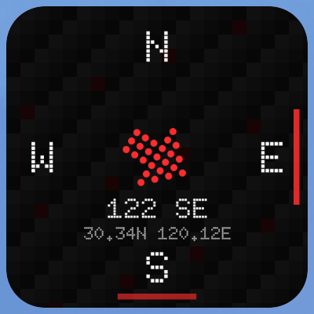

# Nothing Compass Widget 🧭

一个轻量的 Nothing 风格 Android 指南针桌面小组件。纯 Java 实现，不依赖 Gradle 或 Android Studio。

v2 只保留黑色圆角卡片版本，使用 Doto 点阵字体、静态无缝方格背景和红色点阵方向箭头，并显示低频读取的最近经纬度。



## 功能

- 黑色圆角卡片，适配不同 Launcher 网格和组件宽高比
- Doto 700 点阵字体显示 N / E / S / W、角度与方向
- 优先使用系统旋转矢量传感器，回退到加速度计 + 磁力计
- 显示最近可用的经纬度，每 5 分钟低频重新读取一次
- 根据屏幕旋转重映射传感器坐标
- 磁场精度不可靠时显示 `CALIBRATE`
- 屏幕熄灭后停止传感器，亮屏后自动恢复
- 点击组件可打开 ColorOS 指南针（已安装时）
- 新增组件时由 Provider 立即提供静态指南针和点击跳转，不再依赖动态服务先启动
- 只为经纬度申请定位权限，不申请存储或电话权限

## 尺寸适配

当前以 OnePlus 7T Pro、OPlus Launcher `3×5` 为主验收基准。该网格的 1×1 宿主高度比宽度约多 10 个物理像素，因此卡片使用左右 9dp、上下 10.5dp 的固定适配边距，将可见外框校正为正方形。这是当前设备与网格的视觉适配值，不是 Android 通用常量。

外框使用 14dp XML 圆角；方格背景使用 `centerCrop`并被外框统一裁切；罗盘使用独立 512×512 透明坐标系和 `fitCenter`，内部罗盘、文字和箭头不会变形。

不使用 `fitXY` 或单侧 margin：四边对称边距使组件放在桌面左侧和右侧时都遵守同一对齐规则。

## 性能策略

- 传感器保持较高采样频率，用于角度平滑；
- RemoteViews 最多每 100 ms 更新一次，即最高约 10 FPS；
- 角度变化小于 0.25° 时跳过重复画面，每 1 秒强制同步一次；
- 一帧只绘制一次，所有组件实例共享同一张内容位图；
- 使用两个 512×512 Bitmap 交替绘制，避免每个传感器事件重新分配大图；
- 方格背景只生成一次并缓存；
- 屏幕关闭时注销传感器监听。

这些限制用于解决旧版高频创建 Bitmap、频繁 Binder 传输导致的卡顿和偶发无响应。

## 安装

仓库根目录的 `compass-widget.apk` 是当前稳定 APK。v2 包名为 `com.unimend.nothingcompass`，可与旧版 `com.example.compasswidget2` 共存：

```bash
adb install -r compass-widget.apk
```

安装后：长按桌面空白 → 小组件 → 找到“点阵指南针” → 拖到桌面。确认新版稳定后，可以手动移除旧版组件和旧应用。

## 构建

macOS：

```bash
./build.sh
```

Windows PowerShell：

```powershell
.\build.ps1
```

构建依赖 JDK 17、Android SDK Build Tools 34.0.0 和 Android 34 Platform。macOS 脚本默认复用 Unity 2022.3.52f1c1 的 Android 工具链。

构建产物：`build/compasswidget2.apk`

APK 元数据：

- 包名：`com.unimend.nothingcompass`
- versionName：`2.4.0`
- versionCode：`7`
- minSdk：23
- targetSdk：31

## 代码结构

| 文件 | 作用 |
|---|---|
| `CompassService.java` | 传感器、平滑、节流、屏幕生命周期、绘制与组件更新 |
| `CompassBlackWidgetProvider.java` | 单一黑底组件生命周期 |
| `widget_layout.xml` | 底板、纹理、等比内容和点击层 |
| `widget_info_black.xml` | Launcher 尺寸和调整规则 |
| `assets/doto.ttf` | Doto 700 英文点阵字体 |
| `assets/DOTO-OFL.txt` | Doto 的 SIL OFL 1.1 许可证 |

## 字体与许可

Doto 来自 [Google Fonts / Doto](https://github.com/google/fonts/tree/main/ofl/doto)，采用 SIL Open Font License 1.1。项目代码使用 MIT License。
